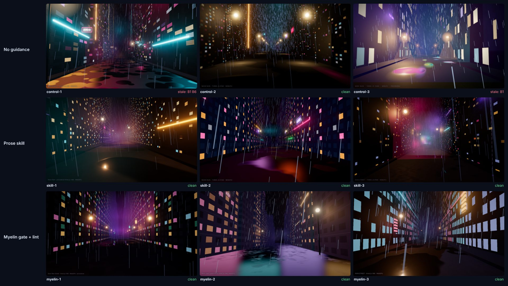

# Benchmarks

Tests 1 to 3 are reproducible from this repo. They measure one thing: **does a ledger flag stale library code, and leave current code alone?**
Tests 4 and 5 add agent runs: does a model given a ledger write less stale code? 24 agents across two model families (GLM 5.3, Claude Haiku 5.5) and three three.js scenes.
Tests 6 and 7 are about [derived ledgers and agent hooks](docs/DERIVE.md): what a ledger read from `node_modules` is worth, and whether a hook changes what an agent ships.

## 1. Labelled corpus

Every library ships `libs/<id>/bench/`: realistic files a model with stale training would write (`bad/`), files written the current way, mostly adapted from official docs and examples (`good/`), and `expected.json` naming exactly which rules must fire on each file.

```
npm run bench
```

| lib | bans | bad files | caught | good files | clean | rule recall | precision |
| --- | --- | --- | --- | --- | --- | --- | --- |
| ai-sdk | 20 | 8 | 100.0% | 6 | 100.0% | 100.0% | 100.0% |
| angular | 16 | 10 | 100.0% | 7 | 100.0% | 100.0% | 100.0% |
| astro | 14 | 9 | 100.0% | 7 | 100.0% | 100.0% | 100.0% |
| drizzle | 13 | 10 | 100.0% | 7 | 100.0% | 100.0% | 100.0% |
| eslint | 19 | 8 | 100.0% | 6 | 100.0% | 100.0% | 100.0% |
| express | 14 | 7 | 100.0% | 5 | 100.0% | 100.0% | 100.0% |
| mongoose | 17 | 9 | 100.0% | 7 | 100.0% | 100.0% | 100.0% |
| nextjs | 20 | 12 | 100.0% | 8 | 100.0% | 100.0% | 100.0% |
| openai | 16 | 10 | 100.0% | 6 | 100.0% | 100.0% | 100.0% |
| prisma | 15 | 7 | 100.0% | 7 | 100.0% | 100.0% | 100.0% |
| react | 20 | 10 | 100.0% | 7 | 100.0% | 100.0% | 100.0% |
| react-router | 17 | 10 | 100.0% | 6 | 100.0% | 100.0% | 100.0% |
| svelte | 22 | 11 | 100.0% | 8 | 100.0% | 100.0% | 100.0% |
| tailwind | 10 | 9 | 100.0% | 7 | 100.0% | 100.0% | 100.0% |
| tanstack-query | 16 | 9 | 100.0% | 7 | 100.0% | 100.0% | 100.0% |
| three | 21 | 11 | 100.0% | 7 | 100.0% | 100.0% | 100.0% |
| vitest | 17 | 9 | 100.0% | 7 | 100.0% | 100.0% | 100.0% |
| vue | 20 | 10 | 100.0% | 8 | 100.0% | 100.0% | 100.0% |
| zod | 17 | 8 | 100.0% | 6 | 100.0% | 100.0% | 100.0% |
| **TOTAL** | **324** | **177** | **100.0%** | **129** | **100.0%** | **100.0%** | **100.0%** |

- **caught**: stale files with at least one rule firing. **clean**: current files with no rule firing.
- **rule recall / precision**: per-rule, against `expected.json`. A rule that fires where it shouldn't, or stays quiet where it should fire, counts against these.
- Caveat: the corpus was written by the same research pass that wrote the rules. It proves each rule does what it says; it is not an independent sample. Tests 2 and 3 are the independent checks.

## 2. Cross-library sweep

Every ledger is run over every **other** library's current (`good/`) files. A ledger that fires on correct React Router code while you're working in Next.js would be noise.

```
node bin/myelin.mjs bench --cross
```

Result: **19 ledgers x other libs' good files: 2322 checks, 0 cross-library false positive(s)**

This test found real problems during development (Next.js's `params.x` rule firing on React Router and SvelteKit loaders, ESLint's `plugins: [` rule firing on Vite configs, Svelte's `<slot>` rule firing on Vue). Each was fixed in the rule, not the corpus.

## 3. In the wild: official example code

Upstream example code from an **old** release and the **current** release, untouched. A good ledger fires on most old files and almost none of the new ones.

```
npm run bench:wild     # sparse-clones ~60 MB of upstream examples into .wild/
```

| corpus | files | flagged |
|---|---|---|
| three.js **r150** examples (all, 2023) | 408 | **399 (97.8%)** |
| three.js **r186** WebGPU examples (`webgpu_*.html`) | 230 | **1 (0.4%)** |
| Next.js **14.2** App Router example files | 252 | 32 (12.7%) |
| Next.js **16.4.3** App Router example files | 401 | 20 (5.0%) |

**three.js.** The one r186 hit is `webgpu_tsl_compute_attractors_particles.html`, line 227: `// const delta = timerDelta()...`, an old API left in a **comment**. Regexes can't tell comments from code ([known limit](docs/SPEC.md#10-known-limits)). Most r150 files are flagged by B14 (the ledger targets WebGPU, and r150 is WebGL); with B14 excluded, **263 of 408 (64%)** still use APIs that were removed or deprecated by r186 (`outputEncoding`, `THREE.Clock`, `ShaderMaterial`, `EffectComposer`...).

**Next.js.** Most App Router examples don't touch the APIs that changed, so the old rate is low by nature. The interesting part is the 20 hits in **Next.js's own v16.4.3 examples folder**. Reading each flagged line: **19 are real pre-16 code** still in the official examples (synchronous `params` / `searchParams`, `draftMode().enable()` without `await`, `headers().get()`, single-argument `revalidateTag`, `next/head` in an App Router page). **1 is a false positive** (`cms-sanity/app/(blog)/more-stories.tsx`: a component whose own prop happens to be named `params`). Full list: [eval/wild/results.json](eval/wild/results.json).

In other words: even official examples lag behind the library. That is the code models train on.

## 4. Agent A/B: bonfire scene (three.js r186)


Six GLM 5.3 agents, same task, three arms of two: no guidance, the r186 rules as prose (`SKILL.md`), and the Myelin gate plus mandatory lint. Both unguided agents used `THREE.Clock` and `PCFSoftShadowMap` (lint B5, B6), and three.js printed exactly those two warnings at runtime. All four guided agents were clean and warning-free; all six rendered. Prose and gate tied at this sample size; Myelin's edge is that the check is enforced by a tool, not by the model's reading. Details, outputs and screenshots: [`eval/bonfire-ab/`](eval/bonfire-ab/README.md).

## 5. Agent A/B: lighthouse and neon street, Claude Haiku 5.5 (three.js r186)

18 Haiku 5.5 agents, two scenes, three arms of three: no guidance, the r186 rules as prose (`SKILL.md`), and the Myelin gate plus mandatory lint. Same guidance files as test 4. Each agent saved its first draft before any check, then polished from screenshots that never showed the console.

| Arm | Drafts with a stale r186 API | three.js deprecation warnings | Blind visual score (craft / brief, 1-10) |
|---|---|---|---|
| No guidance | **5 / 6** | 9 | 6.67 / 7.00 |
| Prose skill | 0 / 6 | 0 | 6.22 / 6.11 |
| Myelin gate + lint | 0 / 6 | 0 | 6.17 / 6.94 |

Lint and three.js agreed on all 18 pages: every runtime deprecation warning matched a lint finding, and no clean page printed one. Visual scores (three blind judges) differ by about half a point, within noise. With test 4: **7 of 8 unguided runs wrote a stale API; 0 of 16 guided runs did.** Prose and gate tied on stale-API rate; the gate's ledger is also the check that verified it. Details, all 18 screenshots and outputs: [`eval/agent-ab/`](eval/agent-ab/README.md).



## 6. Derived ledgers

`myelin derive` reads `@deprecated` tags from the installed type declarations. This test installs the 19 libraries at the versions their curated ledgers target (`eval/derive/package-lock.json`), derives one ledger (384 rules from 816 deprecated APIs in 25 packages, 3.4 s), and measures it four ways. Every number below is recomputed by `node eval/derive/run.mjs`; the first column of [`eval/derive/README.md`](eval/derive/README.md) says how each one can mislead.

```
npm run bench:derive     # installs ~1 GB of pinned libraries and clones the example corpora into .derive/
```

**Against the labelled corpus** (test 1's files):

| | stale files caught | current files flagged |
|---|---|---|
| curated ledgers | 177 / 177 | 0 / 129 |
| derived ledger | **15 / 177 (8.5%)** | **1 / 129** |
| ceiling: *every* deprecated name matched loosely | 48 / 177 (27.1%) | 34 / 129 |

The derived ledger catches little of this corpus, and it should. The corpus is code that **breaks** on the current release (removed and renamed APIs, changed config and CSS), and the types of the current release cannot describe an API that no longer exists. The ceiling row shows that even matching every deprecated name with no regard for precision reaches only 27%, at the price of flagging a quarter of the current files. The one current file derive flags is `ai-sdk/good/chat-page.tsx`, which imports `FormEvent`; `@types/react` 19.3.0 marks it `@deprecated`, so the corpus file is the one that is out of date.

**Against official examples**, derived and curated side by side:

| corpus | files | derived flags | curated flags | in both |
|---|---|---|---|---|
| three.js r150 examples (2023) | 408 | 85 | 399 | 85 |
| three.js r186 WebGPU examples | 230 | **0** | 0 | 0 |
| Next.js 14.2 App Router | 252 | 1 | 32 | 0 |
| Next.js 16.4.3 App Router | 401 | 3 | 20 | **0** |

On Next.js 16.4.3's own examples the two ledgers flag **different files, none in common**. The curated one finds removed and changed Next APIs (`params` as a plain object, `next/head`). The derived one finds deprecated React types (`FormEvent`, `FormEventHandler`) that the curated React ledger does not cover and that compile fine. On three.js r186 it says nothing, which is the right answer for current code.

**On two real apps**, read as text at a pinned commit (their dependencies are never installed):

| app | files | findings | what they are |
|---|---|---|---|
| `shadcn-ui/taxonomy` (a Next 13-era app) | 129 | 26 | `React.ElementRef` ×25 in the shadcn components; `z.string().email()` ×1 |
| `vercel/ai-chatbot` (July 2026) | 154 | 4 | `FormEvent`, `FormEventHandler`, `MutableRefObject` ×2 |

All 30 are real uses of an API that the installed declarations mark deprecated. None is a compile error, so `tsc` reports none of them. Every line is printed by the runner to be read.

**What this test found while it was being built**, each fixed in the generator and now a unit test: a local variable named like a deprecated export (`const rangeFog = …`) and a `resolution:` key in an unrelated options object, both false alarms on current three.js examples; a name deprecated on the subpath `ai/test` but live on `ai`, flagged in a file that imported the live one; a message that listed only the first two of four alternatives and so pointed an `onSubmit` handler at `ChangeEvent`; and a pattern that took minutes on a 5,000-line file of unterminated `export {` lists (now 18 ms).

Limits: two apps is a sample, not a rate. The curated and derived ledgers were not tuned against each other. Recall against the labelled corpus is low by construction, and the table says so.

## What would make these numbers stronger

- More model runs: other libraries than three.js, larger models, and more runs per arm. `eval/agent-ab/` has the harness; `eval/run-eval.mjs` scores API-driven runs.
- More wild corpora: React, Svelte and Tailwind example repos pinned at old and current tags.
- Comment stripping before matching (on the [roadmap](docs/ROADMAP.md)) would remove the one three.js false positive.
