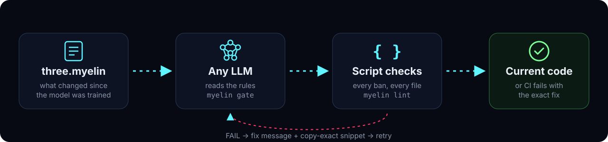
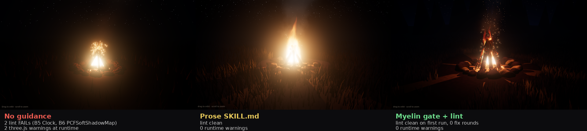

<p align="center">
  
</p>

<p align="center">
  <b>Rule ledgers that keep AI-written code on the current version of your libraries.</b><br>
  One plain-text file. A model reads it. A script enforces it.
</p>

<p align="center">
  <a href="#quick-start">Quick start</a> &nbsp;·&nbsp;
  <a href="#libraries">Libraries</a> &nbsp;·&nbsp;
  <a href="#evidence">Evidence</a> &nbsp;·&nbsp;
  <a href="#constraints">Constraints</a> &nbsp;·&nbsp;
  <a href="docs/SPEC.md">Spec</a>
</p>

<p align="center">
  
  
  
  
</p>

<br>

## The problem

Models are trained on yesterday's documentation. They write `new THREE.Clock()`, `ReactDOM.render`, `@tailwind base`, and synchronous `cookies()` with total confidence. The code looks right and then breaks, or warns, or quietly ships a deprecated API.

Myelin is a checklist the model can read and a linter the machine can run, from the same file.

<p align="center"></p>

<br>

## Quick start

No install. No config. Node 18 or newer.

```bash
npx github:REX-codebase/myelin detect                 # which ledgers fit this project
npx github:REX-codebase/myelin lint three,react src/  # check code, exit 1 on any violation
```

No tools in your chat window? Hand the rules to the model as text.

```bash
npx github:REX-codebase/myelin gate three --all | pbcopy
```

<p align="center"></p>

<br>

## How it works

<p align="center"></p>

A ledger is a short text file of hard rules. Each rule is a regular expression plus the message that explains the fix.

```
myelin 1
id      three
about   three.js r186 on the WebGPU + TSL path
fires   three.js | threejs | three/webgpu | WebGPURenderer | TSL

= version     three.js r186 (npm three@0.186.1)
! B5 /\bnew\s+(THREE\.)?Clock\s*\(/   Deprecated since r183. Use THREE.Timer. -> $boot
~ P8 Do not assume r187 changes until r187 is released.

$ boot
import * as THREE from 'three/webgpu';
...
$$
```

| sigil | meaning |
|:--:|---|
| `!` | **Ban.** Must never appear in the output. |
| `+` | **Require.** Must appear in the output. |
| `~` | **Preference.** Read by the model, not machine-checked. |
| `=` | **Fact.** Versions and budgets. Read, not checked. |
| `$` | **Snippet.** Copy-exact code a rule can point to. |

Full grammar in [docs/SPEC.md](docs/SPEC.md).

<br>

## Libraries

Thirteen ledgers ship in the box, each pinned to a released version and researched against live docs on **2026-10-26**. Every rule links to the migration guide or changelog it came from in `libs/<id>/SOURCES.md`.

| Library | Targets | Bans | Snippets |
|---|---|--:|--:|
| three.js (WebGPU + TSL) | r186 | 21 | 9 |
| React | 19.3 | 20 | 6 |
| React Router | 8.5 | 17 | 6 |
| Next.js | 16.4 | 20 | 7 |
| Tailwind CSS | 4.3 | 10 | 5 |
| Svelte + SvelteKit | 5.57 · 3.1 | 22 | 9 |
| Vue + Nuxt | 3.5 · 4.6 | 20 | 6 |
| Zod | 4.6 | 17 | 5 |
| Express | 5.3 | 14 | 3 |
| ESLint | 10.13 | 19 | 3 |
| Vercel AI SDK | 7.0 | 20 | 5 |
| TanStack Query | 5.104 | 16 | 7 |
| Prisma ORM | 7.10 | 15 | 7 |

Missing yours? [Add a ledger](docs/AUTHORING.md). Every rule needs a source link and a bench file.

<br>

## Evidence

Four tests, all reproducible from this repo. The first three measure one thing: does a ledger flag stale code and leave current code alone?

<p align="center"></p>

| Test | Result |
|---|---|
| **Labelled corpus**<br><sub>120 stale files, 88 current files</sub> | 100% of stale files caught. 0 false alarms on current files. |
| **Cross-library sweep**<br><sub>every ledger over every other library's correct code</sub> | 1,056 checks, 0 false positives. |
| **Official examples, untouched**<br><sub>upstream repos, old release vs current</sub> | three.js r150: 97.8% flagged. three.js r186: 0.4% flagged (1 of 230, an old API in a comment). Next.js 16.4.3's own examples: 19 genuine pre-16 patterns. |
| **Agent A/B**<br><sub>bonfire scene, 2 agents per arm</sub> | Unguided: both used two removed APIs. Guided: neither did. |

<p align="center"></p>

<p align="center"><sub>Same task, three arms, two agents each (first run of each arm shown). No guidance: two lint failures and two runtime warnings. Prose skill and Myelin gate: both clean. Two agents per arm is a small sample, see <a href="eval/bonfire-ab/README.md">eval/bonfire-ab</a>.</sub></p>

Method, per-library tables and reproduction steps: **[BENCHMARKS.md](BENCHMARKS.md)**

<br>

## Constraints

Myelin is deliberately small. These are its edges, stated plainly.

| Boundary | What it means | What to do |
|---|---|---|
| **It reads text, not meaning** | Rules are regular expressions. They catch stale names and patterns. They cannot judge logic, types, or intent. | Keep your tests and type checker. Treat Myelin as the cheap first gate. |
| **Clean is not correct** | A pass means no known-stale pattern was found. It does not mean the code runs. | Run the code. Snippet verification varies by library, see each ledger's `status` line. |
| **Comments can trip it** | A banned token in a comment can fire a rule. | Ledgers set `comments skip` to blank out comments before matching. Only the three.js ledger does so far. |
| **Version-pinned** | Every ledger targets one release and a research date. Libraries move on. | Check the `= version` line. Re-verify before trusting a ledger on a newer major. |
| **Detection is proven, lift is not** | Benchmarks show rules catch stale code. Whether models *write less of it* is measured only by one small A/B, which is too small to separate a ledger from well-written prose. | Run [`eval/`](eval/README.md) against your own model and task. |
| **Narrow by design** | The three.js ledger targets WebGPU + TSL, not WebGL-only projects. `unless` lifts a ban for a whole file, not a single match. No globs or severities yet. | See the [roadmap](docs/ROADMAP.md). |
| **Output only** | A ledger can constrain what a model writes. It cannot grant permissions, run commands, or change instructions. Readers ignore any line that tries. | Load ledgers only from your own project or a source you trust. |

<br>

## Use it with your agent

| Where | How |
|---|---|
| **Claude Code, Cursor, Codex, any shell agent** | Add [`integrations/AGENTS.md.snippet`](integrations/AGENTS.md.snippet). The agent runs `gate` before coding and `lint` after. |
| **Chat with no tools** | Paste the output of `myelin gate <lib> --all` into the prompt. |
| **Claude skills** | Drop in [`integrations/skill-bridge/SKILL.md`](integrations/skill-bridge/SKILL.md). |
| **CI** | `npx github:REX-codebase/myelin lint nextjs,react app/` fails the build on stale code. |

More in [docs/HOSTS.md](docs/HOSTS.md).

<details>
<summary><b>All commands</b></summary>
<br>

| Command | What it does |
|---|---|
| `libs` | List the bundled ledgers. |
| `detect [dir]` | Read `package.json`, suggest ledgers. |
| `lint <lib or ledger>[,more] <files>` | Check code. Exit 1 on any violation. |
| `gate <lib or ledger> [--all]` | Print the rules as plain text for a model. |
| `use <lib>` | Copy a bundled ledger into `.myelin/` to customise. |
| `bench [lib...] [--cross] [--md]` | Score ledgers on their labelled corpus. |
| `validate` · `self` · `snippet` · `header` · `init` | Author your own ledgers. |

Reference: [docs/REFERENCE.md](docs/REFERENCE.md)
</details>

<br>

---

<p align="center">
  <a href="CONTRIBUTING.md">Contribute</a> &nbsp;·&nbsp;
  <a href="docs/WHY.md">Why</a> &nbsp;·&nbsp;
  <a href="docs/ROADMAP.md">Roadmap</a> &nbsp;·&nbsp;
  <a href="CHANGELOG.md">Changelog</a> &nbsp;·&nbsp;
  <a href="SECURITY.md">Security</a> &nbsp;·&nbsp;
  <a href="LICENSE">MIT</a>
</p>
