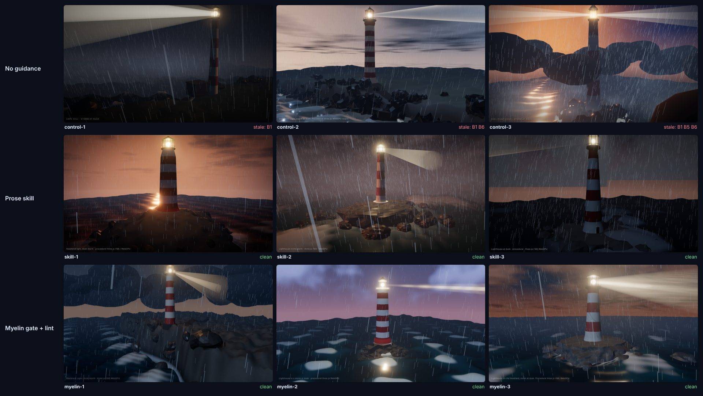

# Agent A/B: no guidance vs prose skill vs Myelin (Haiku 5.5)

18 agents, 2 scenes, 3 arms, 3 runs per arm per scene. All agents were Claude Haiku 5.5 (medium effort), run 2026-10-26. This follows the smaller GLM 5.3 [bonfire A/B](../bonfire-ab/README.md) with three times the runs and two new scenes.

**Task:** write one self-contained `index.html`: a portfolio-quality real-time scene in three.js **r186** (`three@0.186.1`) on **WebGPURenderer**. No web access, no docs, no `node_modules`.

| Scene | Brief |
|---|---|
| lighthouse | lighthouse on a rocky headland in a storm at dusk: sweeping beam, rough ocean and foam, wet rocks, rain, clouds, lightning, bloom, shadows |
| neon | rainy cyberpunk street at night: building canyon, lit windows, neon in 3+ colours, wet road mirroring the neon, rain, haze, lamps, bloom |

| Arm | Guidance given | Enforcement |
|---|---|---|
| control | none | self-review only |
| skill | [`inputs/SKILL.md`](inputs/SKILL.md): the r186 rules as prose | self-review against the skill |
| myelin | [`inputs/three.gate.txt`](inputs/three.gate.txt) (`myelin gate three --all`) | must run `myelin lint three` and fix until clean |

The guidance files are byte-identical to the bonfire A/B inputs. Every agent saved its first complete version as `draft.html` before any check, then could take up to 3 screenshots of its page to improve the look. Screenshots showed the picture only, never the browser console, so runtime warnings could not steer any arm. Full prompts: [`prompts/`](prompts/).

## Results

### Stale APIs (first draft, lint, confirmed by three.js at runtime)

| Arm | Drafts with a stale r186 API | Rules hit | three.js deprecation warnings at runtime |
|---|---|---|---|
| control | **5 / 6** | B1 ×5, B6 ×3, B5 ×1 | 9 |
| skill | 0 / 6 | none | 0 |
| myelin | 0 / 6 | none | 0 |

- B1 `PostProcessing` (renamed `RenderPipeline` in r183), B5 `THREE.Clock` (deprecated r183), B6 `PCFSoftShadowMap` (removed r186).
- **The lint and three.js agreed on every page.** Each deprecation warning three.js printed was predicted by a lint finding, and no lint-clean page printed one. (Two control pages also printed `AttributeNode: Vertex attribute "position" not found`, a scene bug, not a version issue, which a ledger is not meant to catch.)
- No control agent removed a stale API while polishing, because nothing told it the API was stale: every final page matches its draft.
- All 6 Myelin first lints were clean, so the myelin arm used 0 fix rounds. The gate alone was enough; the lint confirmed it.
- `neon/control-1` edited its file before saving `draft.html` (disclosed by the agent), so its draft is not byte-identical to its first write.

### Visual quality (blind)

Three Haiku 5.5 judges scored every final screenshot, with file names shuffled and arms hidden, 1-10 for craft and for coverage of the brief ([rubric](prompts/judge-rubric.txt), raw scores in [`judging.json`](judging.json)). Mean of 3 judges, then of 6 runs:

| Arm | Craft | Brief |
|---|---|---|
| control | 6.67 | 7.00 |
| skill | 6.22 | 6.11 |
| myelin | 6.17 | 6.94 |

The differences are about half a point on a 10-point scale with 6 runs per arm: within run-to-run noise. **Guidance did not make the scenes look better or worse; it changed whether they used current APIs.** That is what a ledger is for.

### Screenshots




## What this shows

- Without guidance, Haiku 5.5 wrote a stale three.js API in 5 of 6 pages. With either form of guidance, 0 of 12 did. Combined with the GLM 5.3 bonfire run (2 of 2 unguided stale, 0 of 4 guided), that is **7 of 8 unguided runs vs 0 of 16 guided runs**, across two model families and three scenes.
- Prose and the Myelin gate again tied on stale-API rate. What Myelin adds is the machine check: the same ledger that guided the model also verified the output, and its verdict matched three.js's own runtime warnings on all 18 pages. A prose skill cannot tell you whether it was followed.
- Visual quality is set by the model, not by the guidance.

## Limits

- 3 runs per arm per scene, one model per experiment. Not a statistical study.
- Rendering used WebGPU on a software GPU (SwiftShader). Frame rate was not measured.
- Judges were the same model family as the authors.

## Reproduce

```bash
# lint every run
node bin/myelin.mjs lint three eval/agent-ab/outputs/*/*/index.html
# render and score (needs Playwright's Chromium and a local copy of three@0.186.1: npm pack three@0.186.1)
node eval/agent-ab/score.mjs <runs-dir> <path-to-unpacked-three-package>
```

`results.json` has the draft and final lint, the agent's own first lint (myelin arm) and the runtime console per run.

## Showcase (polished, not part of the comparison)

The README demo uses the top-judged Myelin run of each scene (`myelin-3` in both, by the blind scores above), polished further by Haiku 5.5 with up to six more screenshot rounds against an art-direction brief, linting after every edit. These are a demonstration of the Myelin workflow, not experiment results: the other arms were not polished. Both final pages lint clean and printed nothing to the console when rendered. Files: [`showcase/`](showcase/).
