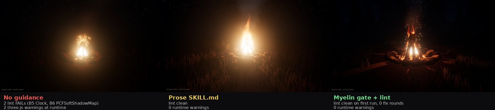
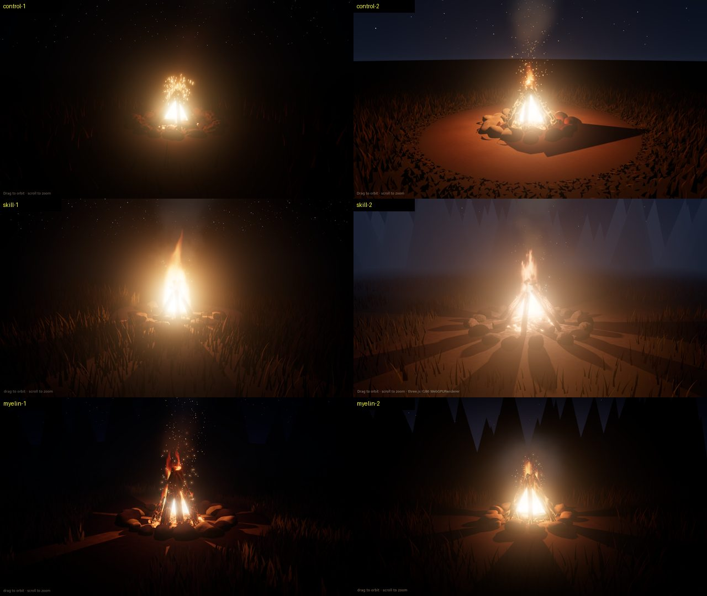

# Bonfire A/B: no guidance vs prose skill vs Myelin gate

A small, non-statistical experiment (2 agents per arm, all GLM 5.3, run 2026-10-26).

**Task (identical for all six agents):** write one self-contained `index.html` with a realistic night-time bonfire scene in three.js **r186** (`three@0.186.1` from jsdelivr) on **WebGPURenderer** (flames, sparks, smoke, logs, stones, ground, lighting). No web search, no docs, no `node_modules`, no other workspace files. Report techniques and API uncertainties.

| Arm | Guidance given | Enforcement |
|---|---|---|
| control | none | none |
| skill | `inputs/SKILL.md`: the same r186 rules written as prose | none (self-review) |
| myelin | `inputs/three.gate.txt` (`myelin gate three`) | must run `myelin lint three` and fix until clean |

## Results



*Run 1 of each arm. All six runs are in the grid below and in `outputs/`.*


| Run | First lint (`myelin lint three`) | Console warnings at runtime | Renders |
|---|---|---|---|
| control-1 | FAIL B5 (Clock), B6 (PCFSoftShadowMap) | Clock deprecated; PCFSoftShadowMap removed | yes |
| control-2 | FAIL B5, B6 | same two | yes |
| skill-1 | clean | none | yes |
| skill-2 | clean | none | yes |
| myelin-1 | clean (0 fix rounds) | none | yes |
| myelin-2 | clean (0 fix rounds) | none | yes |

All six runs:



Every lint finding was confirmed by three.js itself: the controls' runtime console shows exactly the two warnings the lint predicted, and no page without a lint failure printed any three.js warning. All six pages rendered (headless Chromium, WebGPU on SwiftShader/Vulkan). Software rendering ran at well under 1 fps, so no performance comparison is possible here.

## What this does and does not show

- Without guidance, both agents used two APIs that r186 deprecated or removed. With either form of guidance, neither did.
- **Prose and the gate tied on this task.** The difference Myelin adds is that the check is machine-run and repeatable (a CI step, the same verdict every time), while the skill arm relied on the model reading and obeying prose. Two runs per arm cannot separate the two.
- Visual quality is subjective and varied more within arms than between them (see the grid).
- Lint bug found and fixed: the first pass flagged both skill pages for B6 because each had a comment saying `// PCFSoftShadowMap removed`. 0.2.1 adds the `comments skip` header key (used by the three ledger) so comments no longer count. Results above use 0.2.1.

## Reproduce

```bash
# lint
node bin/myelin.mjs lint three eval/bonfire-ab/outputs/*/index.html
# render (needs Chromium with WebGPU; serve three@0.186.1 locally or allow jsdelivr)
node eval/bonfire-ab/render.mjs http://127.0.0.1:8765/control-1/index.html out.png 12000
```

`results.json` has the lint JSON and console output per run.
